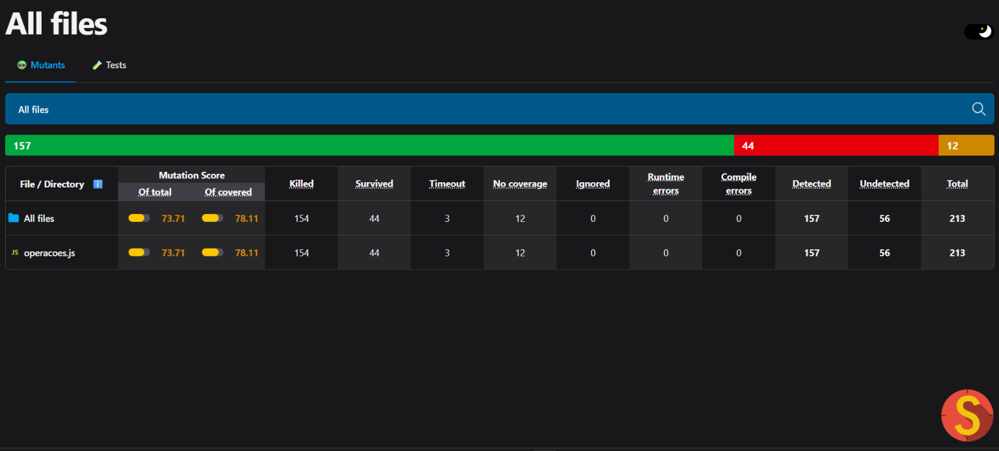
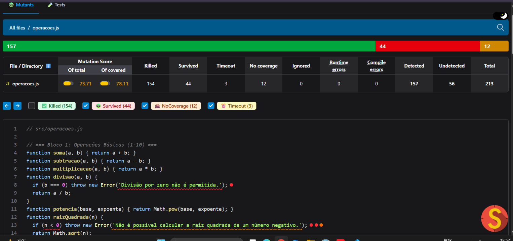
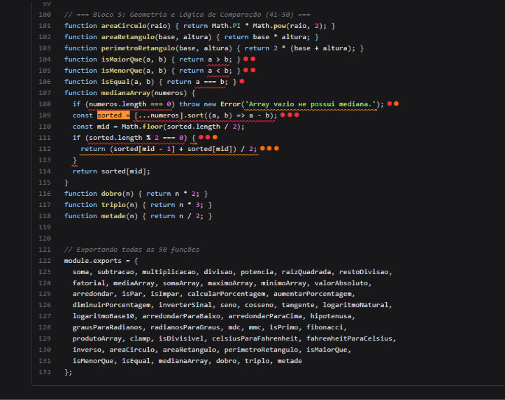
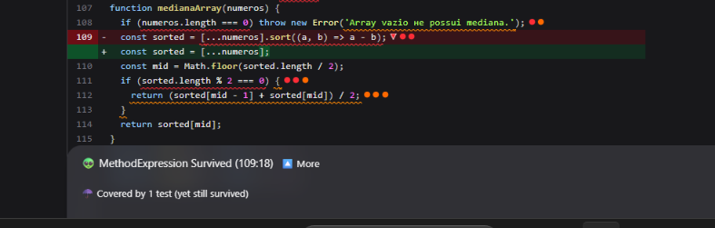
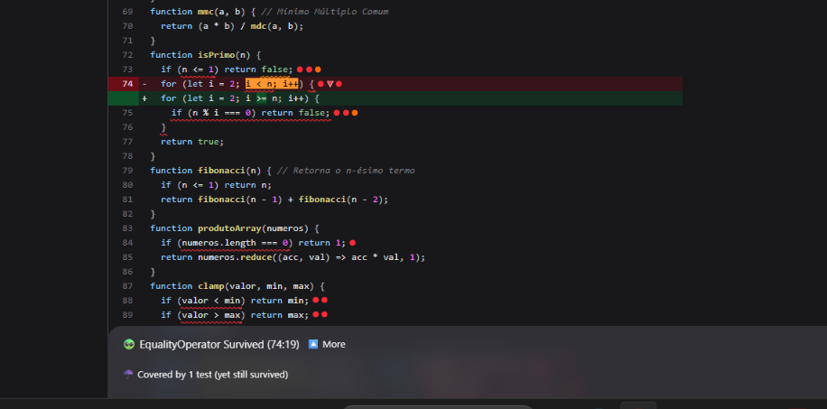
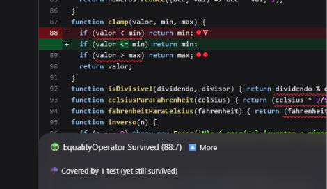
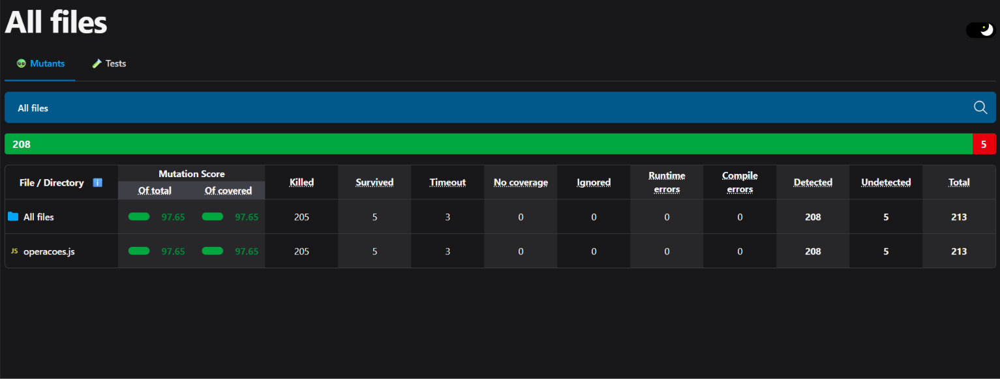
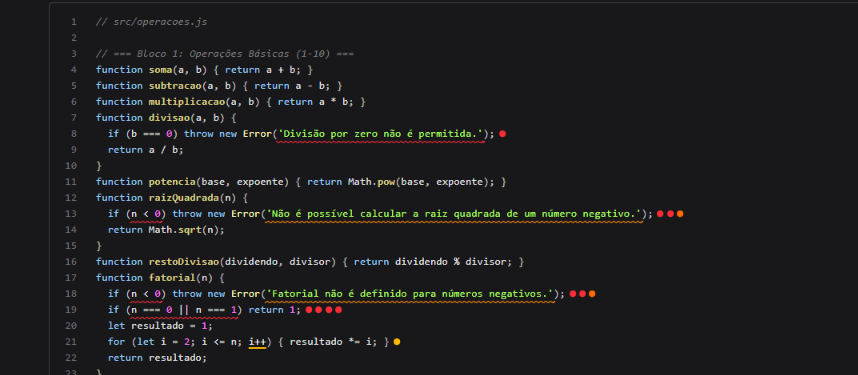

# Notas para o relatório — Teste de Mutação com StrykerJS

Projeto: `src/operacoes.js` (50 funções) · Testes: Jest · Ferramenta: StrykerJS 10.0.0 (`@stryker-mutator/jest-runner`, `coverageAnalysis: "perTest"`).

Arquivos de evidência nesta pasta:

| Arquivo | Conteúdo |
|---|---|
| `cobertura-inicial.txt` / `cobertura-final.txt` | Saída de `npm test -- --coverage` antes e depois |
| `stryker-inicial.txt` / `stryker-final.txt` | Saída completa de `npx stryker run` antes e depois |
| `mutation-inicial/mutation.html` | Relatório HTML da **primeira** execução (para os screenshots dos sobreviventes) |
| `mutation-final/mutation.html` | Relatório HTML da execução final |
| `sobreviventes-inicial.md` | Lista dos 56 mutantes não detectados na primeira execução |
| `screenshots/` | Capturas dos relatórios HTML (inicial e final) |
| `relatorio-teste-mutacao.pdf` | **Relatório final de entrega**, em PDF |

---

## 1. Situação inicial

### Cobertura de código inicial (50 testes)

| Statements | Branches | Functions | Lines |
|---|---|---|---|
| 85,41% | 58,82% | 100% | 98,64% |

Única linha não executada: 112 (ramo de array com quantidade par em `medianaArray`).

### Mutation score inicial

| Total de mutantes | Killed | Timeout | Survived | No coverage | **Mutation score** |
|---|---|---|---|---|---|
| 213 | 154 | 3 | 44 | 12 | **73,71%** (78,11% sobre o código coberto) |



*Figura 1: resumo da primeira execução. Em vermelho, os 44 sobreviventes; em laranja, os 12 sem cobertura.*



*Figura 2: visão do código filtrada para os mutantes não detectados. Cada bolinha no fim da linha é um mutante (vermelho = sobreviveu, laranja = sem cobertura). Já na linha 8 aparece o mutante da mensagem de erro de `divisao`, e na linha 13 a fronteira `n < 0` de `raizQuadrada`.*

### Por que os números são tão diferentes?

A cobertura mede apenas se uma linha **foi executada** durante os testes. Ela não verifica se o teste **conferiu** o resultado. O teste de mutação mede outra coisa: se a suíte **percebe** quando o código muda. Com 98,64% de linhas cobertas, mais de um quarto dos mutantes (56 de 213) passou despercebido, porque a suíte original:

- **Testava só o "caminho feliz" dos predicados.** `isPar`, `isImpar`, `isEqual`, `isMaiorQue`, `isMenorQue` e `isDivisivel` só eram testados com entradas que devolvem `true`. Por isso um mutante que troca a expressão por `return true` passava.
- **Não testava as fronteiras.** Não havia testes com `a === b`, `n = 0` ou `n = 1`. Por isso as trocas `<` → `<=` e `>` → `>=` sobreviviam.
- **Usava `toThrow()` sem mensagem.** Um mutante que troca a mensagem por `""` continuava lançando erro e passava no teste.
- **Executava guardas sem exercitar o ramo.** A linha `if (numeros.length === 0) ...` conta como coberta mesmo que nenhum teste use um array vazio, então o mutante `if (false)` sobrevivia.
- **Escolhia entradas que escondem o erro.** `medianaArray` era testada com um array já ordenado, então remover o `sort` não mudava nada. As conversões de temperatura usavam 0 °C ↔ 32 °F, valores em que `9/5` e `5/9` são multiplicados por zero, então trocar `*` por `/` dava o mesmo resultado. `isPrimo` só era testada com o primo 7, então apagar o corpo do laço (que é o que detecta compostos) não fazia diferença.

A cobertura de **branches** (58,82%) já indicava o problema: muitos `if` nunca tinham o ramo verdadeiro executado. Mesmo assim, cobertura alta é condição necessária, mas não suficiente.



*Figura 3: bloco 5. Os predicados `isMaiorQue`, `isMenorQue` e `isEqual` (linhas 104–106) e quase toda a `medianaArray` têm sobreviventes. A linha 112 (bolinhas laranja) é a única que a cobertura acusava como não executada; todas as outras bolinhas vermelhas estão em linhas "100% cobertas".*

---

## 2. Os 3 mutantes sobreviventes mais interessantes (1ª execução)

### 2.1 `medianaArray`: o `sort` inteiro pode ser apagado (linha 109)

```diff
-   const sorted = [...numeros].sort((a, b) => a - b);
+   const sorted = [...numeros];
```

Mutador: **MethodExpression** (#48). Na mesma linha também sobreviveram `sort(() => undefined)` (#49, ArrowFunction) e `a + b` no comparador (#50, ArithmeticOperator).



*Figura 4: o Stryker mostra "Covered by 1 test (yet still survived)", ou seja, a linha foi executada por um teste, mas o teste não percebeu a remoção do `sort`.*

**Por que sobreviveu:** o único teste usava `[1, 2, 3, 4, 5]`, que **já está ordenado**. Com ou sem ordenação, o elemento central é 3. A linha foi executada (por isso estava coberta), mas a ordenação nunca fez diferença no resultado.

**Teste que o mata:**

```js
test('ordena antes de escolher o elemento central (array ímpar desordenado) [48-50]', () => {
  expect(medianaArray([5, 1, 3])).toBe(3);
});
```

Sem o `sort`, o elemento central de `[5, 1, 3]` é 1, e o teste falha. O comparador `a + b` é sempre positivo para esses números, então o V8 deixa o array na ordem original e o teste também mata esse mutante.

### 2.2 `isPrimo`: o corpo do laço pode ser apagado (linha 74)

```diff
-   for (let i = 2; i < n; i++) {
-     if (n % i === 0) return false;
-   }
+   for (let i = 2; i < n; i++) {}
```

Mutador: **BlockStatement** (#25). Junto com ele sobreviveram `i < n` → `false` (#23), `i < n` → `i >= n` (#24), `n % i === 0` → `false` (#26) e `n % i` → `n * i` (#27). Além disso, `return false` (#22, #28) e o `n <= 1` (#20, #21) não tinham cobertura ou sobreviviam.



*Figura 5: uma das mutações da mesma linha, `i < n` → `i >= n` (#24). O laço nunca executa e a função devolve `true` para todo `n > 1`, e mesmo assim o teste com `isPrimo(7)` passa. A captura mostra ainda o equivalente de `produtoArray` (linha 84) e os sobreviventes de `clamp` (linhas 88–89).*

**Por que sobreviveu:** o teste só verificava `isPrimo(7) === true`. Uma função que devolve `true` para qualquer `n > 1` passa nesse teste. A lógica que identifica números compostos nunca foi exercitada.

**Teste que o mata:**

```js
test('números compostos não são primos [23-28]', () => {
  expect(isPrimo(4)).toBe(false);
  expect(isPrimo(9)).toBe(false);
  expect(isPrimo(15)).toBe(false);
});

test('1 não é primo [20, 21, 22]', () => {
  expect(isPrimo(1)).toBe(false);
});
```

### 2.3 `clamp`: `<` → `<=`, que só é detectável com `-0` (linha 88)

```diff
-   if (valor < min) return min;
+   if (valor <= min) return min;
```

Mutador: **EqualityOperator** (#31). A versão simétrica, `valor > max` → `valor >= max`, também sobreviveu (#33).



*Figura 6: `valor < min` trocado por `valor <= min`, sobrevivente na primeira execução.*

**Por que sobreviveu:** o teste original só usava `clamp(5, 0, 10)`, um valor no meio do intervalo. Além disso, este mutante é **quase equivalente**. Quando `valor === min`, a função original devolve `valor` e a mutante devolve `min`, que são o mesmo número. Por isso o teste de fronteira óbvio, `clamp(0, 0, 10)`, **não** mata o mutante.

**Teste que o mata:** o único caso em que `valor === min` vale e os dois números ainda são distinguíveis é o par `0` / `-0`. O `toBe` do Jest usa `Object.is`, que diferencia os dois:

```js
test('retorna o próprio valor (não o limite) quando valor === min [31]', () => {
  // -0 e 0 são iguais para <, mas distintos para Object.is (usado pelo toBe):
  // com "valor <= min" a função devolveria min (0) em vez do próprio valor (-0).
  expect(clamp(-0, 0, 10)).toBe(-0);
});

test('retorna o próprio valor (não o limite) quando valor === max [33]', () => {
  expect(clamp(0, -10, -0)).toBe(0);
});
```

É um caso limite: a diferença é real e observável por quem chama a função (por exemplo, `1 / clamp(-0, 0, 10)` dá `-Infinity` no original e `Infinity` na mutante), mas dificilmente importaria na prática. Ele mostra como fica tênue a linha entre um mutante "difícil" e um equivalente.

---

## 3. Situação final

### Mutation score final (85 testes: 50 originais + 35 novos em `test/operacoes.mutantes.test.js`)

| Total de mutantes | Killed | Timeout | Survived | No coverage | **Mutation score** |
|---|---|---|---|---|---|
| 213 | 205 | 3 | 5 | 0 | **97,65%** |



*Figura 7: resumo da execução final. Restam apenas os 5 mutantes equivalentes, e não há mais mutantes sem cobertura.*

Descontando os 5 mutantes equivalentes (abaixo), o score sobre os mutantes que **podem** ser mortos é **100%** (208/208).

### Cobertura final

| Statements | Branches | Functions | Lines |
|---|---|---|---|
| 100% | 100% | 100% | 100% |

### Sobre a meta de 98%

Os 5 sobreviventes restantes são **mutantes equivalentes**: o comportamento observável (o valor de retorno para qualquer entrada) é idêntico ao do código original. Com 213 mutantes, o máximo alcançável sem testes artificiais é 208/213 = **97,65%**, ligeiramente abaixo de 98%. Para passar dos 98% seria preciso, por exemplo, espionar `Array.prototype.reduce` para checar se ele foi chamado em `produtoArray([])`. Isso testaria um detalhe de implementação, não o comportamento, e por isso foi deliberadamente evitado.

**Equivalentes 1 a 4: `fatorial`, linha 19 (#8, #9, #10, #11)**

```js
if (n === 0 || n === 1) return 1;            // original
if (false) return 1;                          // #9
if (n === 0 && n === 1) return 1;             // #8 (nunca verdadeiro → igual a "false")
if (false || n === 1) return 1;               // #10
if (n === 0 || false) return 1;               // #11
```



*Figura 8: as 4 bolinhas na linha 19 são os mutantes equivalentes de `fatorial`. A linha 21 tem um mutante em timeout (amarelo), que conta como detectado.*

Esse `if` é apenas um atalho. Sem ele, para `n = 0` ou `n = 1`, a execução segue para `let resultado = 1; for (let i = 2; i <= n; i++)`. Como `2 <= 0` e `2 <= 1` são falsos, o laço não executa e a função devolve `resultado = 1`, exatamente o mesmo valor. Nenhuma entrada distingue as versões. O teste `fatorial(0) === 1` existe, mas por definição não consegue matar esses mutantes.

**Equivalente 5: `produtoArray`, linha 84 (#29)**

```js
if (numeros.length === 0) return 1;   // original
if (false) return 1;                  // mutante
```

Sem a guarda, `[].reduce((acc, val) => acc * val, 1)` devolve o valor inicial, `1`. O resultado é idêntico.

---

## 4. Tabela completa: mutantes não detectados na 1ª execução e como cada um foi resolvido

Numeração igual à de `sobreviventes-inicial.md`. Os números entre colchetes nos nomes dos testes em `test/operacoes.mutantes.test.js` apontam para esta tabela.

Resumo: **51 mortos** por novos testes, **5 equivalentes**.

| # | Status inicial | Linha:Col | Mutador | Original | Mutado | Resolução |
|---|---|---|---|---|---|---|
| 1 | Survived | 8:32 | StringLiteral | `'Divisão por zero não é permitida.'` | `""` | Morto — `toThrow` com a mensagem exata |
| 2 | Survived | 13:7 | ConditionalExpression | `n < 0` | `false` | Morto — `raizQuadrada(-4)` deve lançar erro com mensagem |
| 3 | Survived | 13:7 | EqualityOperator | `n < 0` | `n <= 0` | Morto — fronteira `raizQuadrada(0)` → 0 |
| 4 | NoCoverage | 13:30 | StringLiteral | `'Não é possível calcular a raiz quadrada de um número negativo.'` | `""` | Morto — mensagem verificada em `raizQuadrada(-4)` |
| 5 | Survived | 18:7 | ConditionalExpression | `n < 0` | `false` | Morto — `fatorial(-1)` deve lançar erro com mensagem |
| 6 | Survived | 18:7 | EqualityOperator | `n < 0` | `n <= 0` | Morto — fronteira `fatorial(0)` → 1 |
| 7 | NoCoverage | 18:30 | StringLiteral | `'Fatorial não é definido para números negativos.'` | `""` | Morto — mensagem verificada em `fatorial(-1)` |
| 8 | Survived | 19:7 | LogicalOperator | `n === 0 \|\| n === 1` | `n === 0 && n === 1` | **Equivalente** — para n=0 ou 1 o laço não executa e o retorno é 1 de qualquer forma |
| 9 | Survived | 19:7 | ConditionalExpression | `n === 0 \|\| n === 1` | `false` | **Equivalente** — idem #8 |
| 10 | Survived | 19:7 | ConditionalExpression | `n === 0` | `false` | **Equivalente** — idem #8 |
| 11 | Survived | 19:18 | ConditionalExpression | `n === 1` | `false` | **Equivalente** — idem #8 |
| 12 | Survived | 25:7 | ConditionalExpression | `numeros.length === 0` | `false` | Morto — `mediaArray([])` → 0 (mutante retorna NaN) |
| 13 | Survived | 34:7 | ConditionalExpression | `numeros.length === 0` | `false` | Morto — `maximoArray([])` deve lançar erro (mutante retorna -Infinity) |
| 14 | NoCoverage | 34:45 | StringLiteral | `'Array vazio не possui valor máximo.'` | `""` | Morto — mensagem exata verificada |
| 15 | Survived | 38:7 | ConditionalExpression | `numeros.length === 0` | `false` | Morto — `minimoArray([])` deve lançar erro (mutante retorna Infinity) |
| 16 | NoCoverage | 38:45 | StringLiteral | `'Array vazio не possui valor mínimo.'` | `""` | Morto — mensagem exata verificada |
| 17 | Survived | 43:28 | ConditionalExpression | `n % 2 === 0` | `true` | Morto — `isPar(7)` → false |
| 18 | Survived | 44:30 | ConditionalExpression | `n % 2 !== 0` | `true` | Morto — `isImpar(4)` → false |
| 19 | Survived | 44:30 | ArithmeticOperator | `n % 2` | `n * 2` | Morto — `isImpar(4)` → false (4*2 !== 0) |
| 20 | Survived | 73:7 | ConditionalExpression | `n <= 1` | `false` | Morto — `isPrimo(1)` → false |
| 21 | Survived | 73:7 | EqualityOperator | `n <= 1` | `n < 1` | Morto — `isPrimo(1)` → false |
| 22 | NoCoverage | 73:22 | BooleanLiteral | `false` | `true` | Morto — `isPrimo(1)` → false |
| 23 | Survived | 74:19 | ConditionalExpression | `i < n` | `false` | Morto — compostos (`isPrimo(4)`, 9, 15) → false |
| 24 | Survived | 74:19 | EqualityOperator | `i < n` | `i >= n` | Morto — compostos → false |
| 25 | Survived | 74:31 | BlockStatement | `for (let i = 2; i < n; i++) { if (n % i === 0) return false; }` | `{}` | Morto — compostos → false |
| 26 | Survived | 75:9 | ConditionalExpression | `n % i === 0` | `false` | Morto — compostos → false |
| 27 | Survived | 75:9 | ArithmeticOperator | `n % i` | `n * i` | Morto — compostos → false |
| 28 | NoCoverage | 75:29 | BooleanLiteral | `false` | `true` | Morto — compostos → false |
| 29 | Survived | 84:7 | ConditionalExpression | `numeros.length === 0` | `false` | **Equivalente** — `[].reduce(fn, 1)` já retorna 1 |
| 30 | Survived | 88:7 | ConditionalExpression | `valor < min` | `false` | Morto — `clamp(-5, 0, 10)` → 0 |
| 31 | Survived | 88:7 | EqualityOperator | `valor < min` | `valor <= min` | Morto — `clamp(-0, 0, 10)` deve devolver -0 (o próprio valor), não o limite 0 |
| 32 | Survived | 89:7 | ConditionalExpression | `valor > max` | `false` | Morto — `clamp(15, 0, 10)` → 10 |
| 33 | Survived | 89:7 | EqualityOperator | `valor > max` | `valor >= max` | Morto — `clamp(0, -10, -0)` deve devolver 0, não o limite -0 |
| 34 | Survived | 92:51 | ConditionalExpression | `dividendo % divisor === 0` | `true` | Morto — `isDivisivel(10, 3)` → false |
| 35 | Survived | 93:51 | ArithmeticOperator | `celsius * 9/5` | `celsius * 9 * 5` | Morto — `celsiusParaFahrenheit(100)` → 212 |
| 36 | Survived | 93:51 | ArithmeticOperator | `celsius * 9` | `celsius / 9` | Morto — `celsiusParaFahrenheit(100)` → 212 |
| 37 | Survived | 94:53 | ArithmeticOperator | `(fahrenheit - 32) * 5/9` | `(fahrenheit - 32) * 5 * 9` | Morto — `fahrenheitParaCelsius(212)` → 100 |
| 38 | Survived | 94:53 | ArithmeticOperator | `(fahrenheit - 32) * 5` | `(fahrenheit - 32) / 5` | Morto — `fahrenheitParaCelsius(212)` → 100 |
| 39 | Survived | 96:7 | ConditionalExpression | `n === 0` | `false` | Morto — `inverso(0)` deve lançar erro (mutante retorna Infinity) |
| 40 | NoCoverage | 96:32 | StringLiteral | `'Não é possível inverter o número zero.'` | `""` | Morto — mensagem exata verificada |
| 41 | Survived | 104:36 | ConditionalExpression | `a > b` | `true` | Morto — `isMaiorQue(5, 10)` → false |
| 42 | Survived | 104:36 | EqualityOperator | `a > b` | `a >= b` | Morto — fronteira `isMaiorQue(5, 5)` → false |
| 43 | Survived | 105:36 | ConditionalExpression | `a < b` | `true` | Morto — `isMenorQue(10, 5)` → false |
| 44 | Survived | 105:36 | EqualityOperator | `a < b` | `a <= b` | Morto — fronteira `isMenorQue(5, 5)` → false |
| 45 | Survived | 106:33 | ConditionalExpression | `a === b` | `true` | Morto — `isEqual(7, 8)` → false |
| 46 | Survived | 108:7 | ConditionalExpression | `numeros.length === 0` | `false` | Morto — `medianaArray([])` deve lançar erro |
| 47 | NoCoverage | 108:45 | StringLiteral | `'Array vazio не possui mediana.'` | `""` | Morto — mensagem exata verificada |
| 48 | Survived | 109:18 | MethodExpression | `[...numeros].sort((a, b) => a - b)` | `[...numeros]` | Morto — array desordenado `[5, 1, 3]` → 3 |
| 49 | Survived | 109:36 | ArrowFunction | `(a, b) => a - b` | `() => undefined` | Morto — array desordenado `[5, 1, 3]` → 3 |
| 50 | Survived | 109:46 | ArithmeticOperator | `a - b` | `a + b` | Morto — array desordenado `[5, 1, 3]` → 3 |
| 51 | Survived | 111:7 | ConditionalExpression | `sorted.length % 2 === 0` | `false` | Morto — array par `[1, 2, 3, 4]` → 2.5 |
| 52 | Survived | 111:7 | ArithmeticOperator | `sorted.length % 2` | `sorted.length * 2` | Morto — array par `[1, 2, 3, 4]` → 2.5 |
| 53 | NoCoverage | 111:32 | BlockStatement | `if (sorted.length % 2 === 0) { return (sorted[mid - 1] + sorted[mid]) / 2; }` | `{}` | Morto — array par `[1, 2, 3, 4]` → 2.5 |
| 54 | NoCoverage | 112:12 | ArithmeticOperator | `(sorted[mid - 1] + sorted[mid]) / 2` | `(sorted[mid - 1] + sorted[mid]) * 2` | Morto — array par `[1, 2, 3, 4]` → 2.5 |
| 55 | NoCoverage | 112:13 | ArithmeticOperator | `sorted[mid - 1] + sorted[mid]` | `sorted[mid - 1] - sorted[mid]` | Morto — array par `[1, 2, 3, 4]` → 2.5 |
| 56 | NoCoverage | 112:20 | ArithmeticOperator | `mid - 1` | `mid + 1` | Morto — array par `[1, 2, 3, 4]` → 2.5 |
